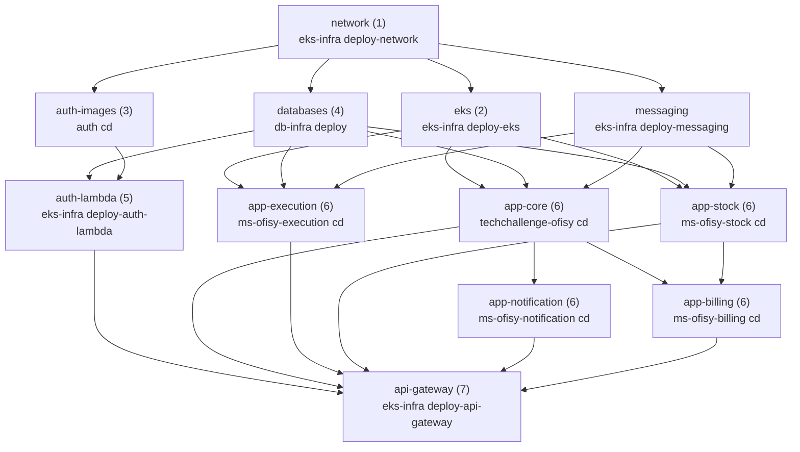
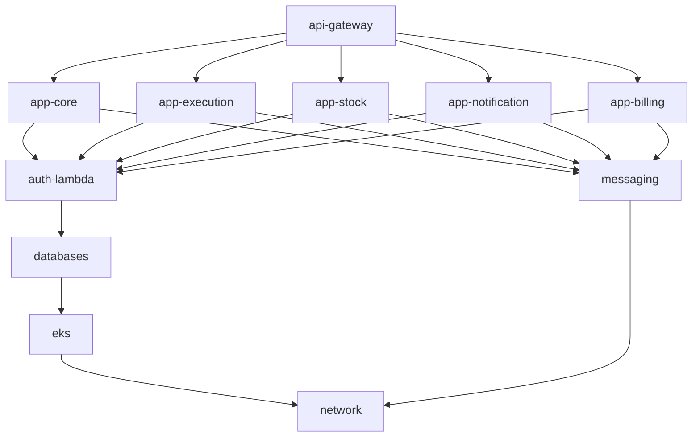

# Ofisy Platform

Orquestrador do ambiente Ofisy na AWS. O AWS Academy expira a sessão a cada 4h, então o ambiente inteiro é recriado com frequência. Em vez de disparar à mão os workflows de cada repositório na ordem certa, este repo tem dois workflows que chamam os dos outros repos como reusable workflows (`workflow_call`):

| Workflow | Arquivo | O que faz |
| :--- | :--- | :--- |
| **Subir ambiente** | `.github/workflows/up.yml` | Provisiona a infra e faz o deploy das aplicações |
| **Destruir ambiente** | `.github/workflows/down.yml` | Destrói tudo no caminho inverso |

Os dois disparam por `workflow_dispatch` (aba **Actions** → **Run workflow**) e compartilham o mesmo grupo de `concurrency`, então um up e um down nunca rodam ao mesmo tempo.

A ordem segue a seção "Ordem de Execução entre os Repositórios" do [README do techchallenge-ofisy-eks-infra](https://github.com/15SOAT-FIAP/techchallenge-ofisy-eks-infra), que é a fonte da verdade. Os workflows chamados são sempre os da branch `master` de cada repo.

## Subir ambiente

- **messaging** não depende da rede, mas espera ela porque é o deploy da rede que cria o bucket do Terraform state (`ofisy-tfstate-<AWS_ACCOUNT_ID>`).
- **auth-lambda** recebe `image_tag` e `authorizer_image_tag` dos outputs do CD do `techchallenge-ofisy-auth`.
- **eks** e **databases** sobem os cinco serviços (`service: all`).
- **app-notification** espera o core, e **app-billing** espera o core e o stock, porque o CD de cada um descobre o NLB interno dessas dependências para configurar as chamadas síncronas.
- **api-gateway** espera todos os microsserviços porque o `plan` descobre o NLB de cada serviço listado em `nlb_service_names`.

## Destruir ambiente

Se uma etapa falhar, as que dependem dela não rodam. O destroy de cada camada lê, por data source, recursos da camada seguinte (o Gateway lê o NLB e as Lambdas, as Lambdas leem o RDS, clusters e bancos leem a rede). Seguir adiante depois de uma falha apagaria esses recursos e deixaria o state da camada que falhou preso, com recursos órfãos. A exceção é a mensageria (`if: ${{ !cancelled() }}`), que não depende de nada e é destruída mesmo se a remoção de algum microsserviço falhar.

Depois de corrigir a falha, rode o down de novo: as camadas com o state já vazio são puladas.

O down pressupõe que o bucket do Terraform state existe. Só o destroy dos bancos verifica isso; os demais falham no `terraform init` se o bucket não existir, por exemplo ao rodar o down numa sessão nova do Academy antes de qualquer up.

## Secrets

Nenhum secret é configurado aqui. Os secrets da organização `15SOAT-FIAP` chegam aos workflows chamados por `secrets: inherit`. A cada nova sessão do AWS Academy, atualize `AWS_ACCESS_KEY_ID`, `AWS_SECRET_ACCESS_KEY` e `AWS_SESSION_TOKEN` na organização.
